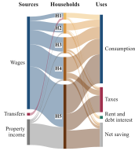
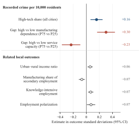

# Jintao Lyu — Selected Research

**Who gains from economic change?**

I study how fiscal institutions and local economic structure shape who benefits from economic change. I combine stock-flow consistent computational modeling with large firm–city datasets, with a focus on distribution and uneven transformation in China.

This repository holds the two projects in my CSH portfolio: their figures, the research code behind them, and short explanations.

## Jobs or Transfers? Job Guarantees, Fiscal Design, and the Dynamics of Inequality

*Working paper · with Huiqing Li*

A stock-flow consistent macro-financial model in R with five household income groups, firms, banks, government, a central bank and the rest of the world. Fifty-six scenarios compare job guarantees with cash transfers, financed by debt or a high-income tax, at equal net fiscal cost.

*How each household group earns and spends its income in the baseline simulation.*

**[Project page, model code and three figures →](jobs-or-transfers/README.md)**

## The Other Side of Progress: High-Tech Expansion and Urban Crime

*Undergraduate thesis · Advisor: Lanlan Wang*

About 7.5 million firm-year tax-survey records turned into city-level high-tech shares and linked with recorded crime and city statistics: a panel of 280 Chinese cities, 2009–2017.

*Fixed-effects estimates, scaled by each outcome's standard deviation.*

**[Project page, data-construction and regression code, two figures →](high-tech-and-urban-crime/README.md)**

## Code in this repository

| Project | Code | What you need |
|---|---|---|
| Jobs or Transfers? | The full model (`equation_ap_csv1.R`), inequality decompositions, and a runner that solves one scenario and checks its accounting | R and the `ineq` package; no data |
| High-tech and crime | Three data-construction scripts (tax records → firm-year file → city high-tech share → city panel) and the baseline regression | Stata 18 with `reghdfe`; the underlying tax-survey and city data are restricted and not included |

## About

Prepared by **Jintao Lyu** · [GitHub](https://github.com/karllouisunder) · October 2026

The JG model is joint work with Huiqing Li; the project pages describe my part. Data are not distributed. No reuse license is granted at this stage.
