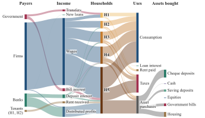
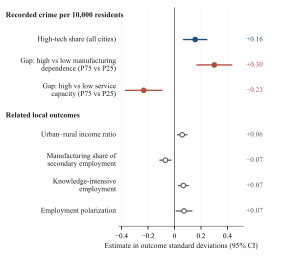

# Jintao Lyu — Selected Research

**Who gains from economic change?**

I study how fiscal institutions and local economic structure decide who benefits when an economy changes. My work combines stock-flow consistent computational models with large firm and city datasets, mostly on China.

This repository holds the two projects in my CSH portfolio, with their figures and the research code behind them.

## Jobs or Transfers? Job Guarantees, Fiscal Design, and the Dynamics of Inequality

*Working paper, with Huiqing Li*

A stock-flow consistent macro-financial model in R with five household income groups, firms, banks, a government, a central bank and a foreign sector. I use it to compare job guarantees with cash transfers that cost the government the same net amount, financed either by debt or by a tax on high incomes.

*Where each household group's income comes from and where it goes, in the baseline simulation.*

**[Project page and model code →](jobs-or-transfers/README.md)**

## The Other Side of Progress: High-Tech Expansion and Urban Crime

*Undergraduate thesis, advisor Lanlan Wang*

I turned about 7.5 million firm-year tax-survey records into city-level high-tech shares and linked them with recorded crime and city statistics, giving a panel of 280 Chinese cities from 2009 to 2017.

*Fixed-effects estimates, each divided by the standard deviation of its outcome.*

**[Project page, data-construction and regression code →](high-tech-and-urban-crime/README.md)**

## Code in this repository

| Project | Code | What you need |
|---|---|---|
| Jobs or Transfers? | The full model (`equation_ap_csv1.R`), the inequality decompositions, and a script that solves one scenario and checks its accounting | R and the `ineq` package; no data |
| High-tech and crime | Three data-construction scripts and the baseline regression | Stata 18 with `reghdfe`; the tax-survey and city data are restricted and not included |

## About

Prepared by Jintao Lyu ([GitHub](https://github.com/karllouisunder)), October 2026.

The JG model is joint work with Huiqing Li, and the project page describes my part. Data are not distributed, and no reuse license is granted at this stage.
