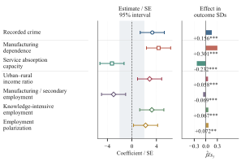
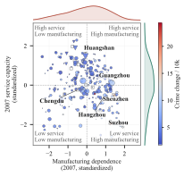

# The Other Side of Progress

## High-Tech Expansion and Urban Crime

**Undergraduate research paper · Jintao Lyu**  
**Advisor: Lanlan Wang**  
[Back to selected research](../README.md)

[Research question](#research-question) · [Run the baseline](#run-the-frozen-baseline) · [Selected visualizations](#selected-visualizations) · [Availability](#availability-and-reproduction)

## Research question

How is high-tech expansion associated with recorded urban crime, and how does that relationship vary with cities' initial industrial structures?

The project examines uneven adjustment to technological change through linked firm–city evidence. It brings together high-tech industry shares, local socioeconomic conditions and recorded criminal cases. The selected figures are **archived observational and exploratory artifacts**. Measurement and identification remain under review; they do not establish causal effects or identified mechanisms.

## My contribution

- Processed approximately **7.5 million firm-year tax-survey records covering 2007–2020**, constructed city-level high-tech industry shares, and linked them with socioeconomic and recorded-crime information.
- Built the benchmark analytical panel of **280 Chinese cities and 2,464 city-years, within 2009–2017**; examined city/year fixed-effects specifications and PPML count models with population exposure.
- Prepared visual summaries of saved estimates, structural moderation and cities' industrial positions, with explicit sample and interpretation limits.

The upstream record coverage and the final estimation sample are different quantities. Neither should be substituted for the sample of every regression or figure below.

## Run the frozen baseline

### What is included

[code/baseline_L1.do](code/baseline_L1.do) is a portable extraction of the current canonical `03_code/stata/04_baseline_L1.do`. It retains the exact dependent variable, treatment, four L1 controls, precomputed eligibility flag, city/year fixed effects, city-clustered inference and numerical acceptance assertions. Input/output paths and explanatory checks are adapted for a standalone example; the research specification is unchanged.

This is a substantive estimation example. **It requires the restricted analytical input; no empirical or synthetic panel is distributed here.** The code does not create substitute data, reconstruct lags or redefine eligibility to recover a preferred number.

### Software and command

- Stata 18 or later, with the `reghdfe` command and its `ftools` dependency already installed. Stata is licensed software.
- The canonical `baseline_city_year_v03.dta` input, obtained through an authorized local project environment. This README does not promise access to it.
- An existing parent directory for a new output folder. Run from the repository root in Stata:

```stata
mkdir "high-tech-and-urban-crime/outputs"
do "high-tech-and-urban-crime/code/baseline_L1.do" "path/to/baseline_city_year_v03.dta" "high-tech-and-urban-crime/outputs/baseline"
```

Replace the input path with an authorized local copy; preserve quotes when paths contain spaces. The script reads the input without changing it and writes only inside the supplied output directory. Choose a new output directory for a new run; an existing run log is protected. Package installation is explicit and separate from execution, rather than performed automatically by the example.

### Input contract and specification

The input must be unique by `city_code year` and contain the following numeric fields. Their definitions come from the parent construction chain; this example does not rebuild or revise them.

| Field | Meaning / treatment in this example |
|---|---|
| `city_code`, `year` | City-year key; city/year fixed effects and city-clustered inference |
| `province_code` | Retained in local estimation-sample keys; not an additional fixed effect here |
| `crime_rate_10k_corrected` | Recorded criminal cases per 10,000 registered residents; the corrected/raw-rate field from the canonical panel |
| `L1_hitech_share_all` | One-year lag of `100 × high-tech firms / all deduplicated firms`; measured in percentage points, not the classified-firm denominator |
| `L1_secondary_ind_legacy` | One-year lag of the legacy secondary-industry share, preserving its archived scale and cleaning |
| `L1_ln_unemp_legacy` | One-year lag of the legacy `ln(registered unemployed persons + 1)` control |
| `L1_ln_gov_expen_legacy` | One-year lag of the legacy log nominal local-budget-expenditure control |
| `L1_ln_gdp_per_legacy` | One-year lag of the legacy log GDP-per-capita control |
| `sample_preferred_core` | Existing binary eligibility flag, inherited unchanged from panel construction |

The eligibility flag is **not simply complete cases for the regression's four controls**. In the source construction it also requires nonmissing `L2_secondary_va_share`, `L2_unemployed_per_10k`, `L2_ln_real_gdppc`, `L2_ln_registered_population`, `province_code` and `registered_population`, alongside the outcome and L1 treatment, and positive registered population. Recreating it from only the displayed regressors would change the frozen benchmark sample. Legacy controls also inherit the source's original cleaning and winsorization order; nominal controls are not silently replaced by real alternatives.

The retained regression is:

```stata
reghdfe crime_rate_10k_corrected L1_hitech_share_all ///
    L1_secondary_ind_legacy L1_ln_unemp_legacy ///
    L1_ln_gov_expen_legacy L1_ln_gdp_per_legacy ///
    if sample_preferred_core, absorb(city_code year) vce(cluster city_code)
```

### Expected results and outputs

For the canonical input, the script requires **b = 0.482869678, SE = 0.145299561, p = 0.001008548, N = 2,464, 280 cities, 2009–2017**, with a `1e-7` tolerance for the reported coefficient, SE and p-value. Failure stops execution; it does not trigger a new sample or specification. The anchors are checks on the code/input combination, not values substituted into the reported estimates.

Successful execution writes:

- `baseline_L1_results.csv`: freshly computed coefficient, SE, two-sided t-based p-value, sample size, city count and year range.
- `baseline_L1_esample.dta`: **private local diagnostic keys** for the estimation sample. Do not publish this output by default.
- `baseline_L1.log`: package locations, regression output and assertion results.

Generated `.dta` files and output directories are excluded by the repository's `.gitignore`; the actual upload list still needs checking. The regression alone does not rebuild the raw-to-panel chain, the archived moderation analyses or the two selected visualizations.

### Local validation, 14 October 2026

The extracted script was run against the authorized local canonical v03 input with Stata 18, `reghdfe` **6.13.1** and `ftools` **2.50.0**. All frozen assertions passed. The actual estimates were **b = 0.482869678098, SE = 0.145299553871, p = 0.001008548308**, with 2,464 observations, 280 cities and the 2009–2017 estimation window. All **2,464 city-year keys**, including their province and estimation-sample markers, matched the accepted local estimation sample.

The SE differs from the historical reported anchor by approximately **7.45 × 10⁻⁹**, within the original `1e-7` acceptance tolerance; this is not a claim of bit-for-bit numerical identity. The source of that very small difference has not been separately isolated. No sample, coefficient or standard error was adjusted to obtain acceptance, and raw-data construction and identification were not revalidated in this run.

## Selected visualizations

### 1. Statistical evidence and structural moderation

[](figures/B_forest.svg)

[Open the vector figure](figures/B_forest.svg)

The figure summarizes seven saved estimates: the recorded-crime benchmark, moderation by initial manufacturing dependence and service absorption capacity, and four related income or employment outcomes.

**How to read it:**

- The center panel places each estimate on an **estimate/standard-error scale** with its transformed 95% interval. It is not a common raw-coefficient scale. The shaded ±1.96 band is a visual reference.
- The right panel divides the estimate by its specification's outcome standard deviation. This does **not** standardize the regressor or make the rows identical economic contrasts.
- The two moderation rows show **P75–P25 contrasts**, rather than the interaction coefficient itself.
- Stars refer to saved, **unadjusted p-values**: `*** p < 0.01`, `** p < 0.05`, `* p < 0.10`. For employment polarization, the within-family Benjamini–Hochberg adjusted **q = 0.124**; its raw-p stars do not imply that it passes a 5% FDR threshold.

| Displayed estimate | City-years | Cities |
|---|---:|---:|
| Recorded crime benchmark | 2,464 | 280 |
| Manufacturing moderation | 2,447 | 276 |
| Service-capacity moderation | 2,447 | 276 |
| Urban–rural income ratio | 2,420 | 275 |
| Manufacturing / secondary employment | 2,461 | 280 |
| Knowledge-intensive employment | 2,173 | 280 |
| Employment polarization | 2,061 | 279 |

The manufacturing outcome is **manufacturing employment relative to secondary-industry employment**, not the secondary-industry share of all employment. Different outcomes and missingness produce different samples. The income-ratio sample reflects the original fixed-effects singleton exclusion.

These results are conditional associations, including exploratory moderation and related-outcome regressions. They are not a formal mediation analysis. The figure does not establish that high-tech expansion caused changes in crime, income distribution or employment.

### 2. Cities within the structural landscape

[](figures/C_city_structure.svg)

[Open the vector figure](figures/C_city_structure.svg)

The horizontal and vertical axes represent standardized **2007 manufacturing dependence** and **2007 service capacity**. The figure contains **276 cities** with structural coordinates; **265** have the required paired 2009/2017 endpoints and **11** lack at least one endpoint measure.

- Marker **area** is proportional to the absolute change in the high-tech share between the endpoints.
- Downward triangles identify **60 cities with declining high-tech shares**; circles indicate nonnegative changes.
- Color represents the endpoint change in recorded criminal cases per **10,000 registered residents**. The color scale spans the actual paired-sample range; all observed paired changes in this selected sample are positive.
- Hollow squares identify the **11 cities without complete endpoints**. They are retained to show structural coverage, rather than silently dropped.
- Marginal curves describe the distribution of the structural coordinates; selected city labels provide reference points.

This is a descriptive structural landscape, not a geographic map, a dynamic phase portrait or an estimated joint response surface. Differences in marker color do not identify the effect of high-tech expansion. No policy threshold or fitted friction contour is claimed.

## Methods and provenance

The empirical project combines firm tax-survey information with city statistics and aggregate recorded-crime measures. The selected figures were prepared from **saved estimates and archived analytical outputs**, including a baseline L1 specification and exploratory structural moderation. They were not re-estimated for this collection.

Figure preparation uses specification-specific samples and outcome standard deviations. It preserves the distinction between interaction estimates and percentile contrasts, raw p-values and adjusted q-values, and upstream data coverage and final analytical samples.

The project's current research status is **identification reset**. These archived artifacts illustrate data construction, exploratory analysis and evidence communication; they should not be taken as results newly validated under a completed identification design. Recorded cases also measure administrative reporting, rather than every underlying incident of crime.

## Availability and reproduction

This collection provides two SVG figures, accompanying explanations and the focused baseline-regression example above. It does not include tax-survey microdata, linked panels, city-level derived plotting records, the complete data-construction chain or a full paper replication package. The selected figures still refer to saved archived estimates; running the baseline example does not re-estimate their exploratory moderation or related-outcome rows.

Public availability of the figures does not imply that the underlying datasets are publicly redistributable. Any later data or code release requires a separate determination of the permissible scope.

[Back to selected research](../README.md)
