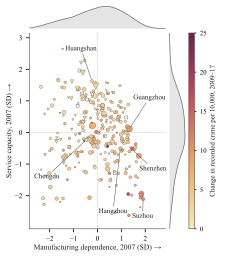

# The Other Side of Progress

## High-Tech Expansion and Urban Crime

**Undergraduate thesis · Jintao Lyu · Advisor: Lanlan Wang** · [Back to selected research](../README.md)

## Question

When high-tech industry expands in a Chinese city, who benefits, and how does uneven opportunity show up in recorded crime? Does the answer depend on where the city started: how much it relied on manufacturing, and how much service-sector capacity it had to absorb displaced workers?

I built the data from the ground up: about **7.5 million firm-year records** from China's national tax survey (2007–2020), classified into high-tech and other industries, aggregated to city-level high-tech shares, and linked with recorded criminal cases and the China City Statistical Yearbook. The estimation panel covers **280 cities and 2,464 city-years (2009–2017)**.

## Key findings

City and year fixed effects, standard errors clustered by city:

- **Higher high-tech share, more recorded crime.** A one-percentage-point higher high-tech share (lagged one year) is associated with 0.48 more recorded criminal cases per 10,000 residents (SE 0.15, p = 0.001), about 0.16 of a standard deviation.
- **Initial structure matters.** In exploratory interaction models, the association is stronger in manufacturing-dependent cities (+0.30 SD, comparing the 75th with the 25th percentile) and weaker where service capacity is high (−0.23 SD).
- **Uneven local gains.** In the same cities, a higher high-tech share goes with a wider urban–rural income ratio, more knowledge-intensive employment, more employment polarization and a smaller manufacturing share of secondary-sector jobs (each 0.06–0.07 SD).

## Figures

**Estimates in outcome standard deviations.** Each row is a separate regression; bars are 95% confidence intervals.


| Row | City-years | Cities |
|---|---:|---:|
| Recorded crime | 2,464 | 280 |
| Manufacturing and service interactions | 2,447 | 276 |
| Urban–rural income ratio | 2,420 | 275 |
| Manufacturing share of secondary employment | 2,461 | 280 |
| Knowledge-intensive employment | 2,173 | 280 |
| Employment polarization | 2,061 | 279 |

**Cities by initial industrial structure.** Each marker is a city placed by its 2007 manufacturing dependence and service capacity. Size shows the change in high-tech share from 2009 to 2017 (triangles: decline); colour shows the change in recorded crime. Hollow squares mark the 11 of 276 cities without data for both years.



## My contribution

- Cleaned and classified the 7.5 million tax-survey records, built the city-level high-tech share, and linked it with crime and city statistics.
- Estimated the fixed-effects and Poisson (PPML) models, the interaction models and the related-outcome regressions.
- Made the figures in this repository.

## Code

| File | Role |
|---|---|
| [code/01_clean_firm_data.do](code/01_clean_firm_data.do) | Tax-survey records 2007–2020 → cleaned firm-year file with four-digit industry codes and the 181-code high-tech list |
| [code/02_construct_hightech_treatment.do](code/02_construct_hightech_treatment.do) | Firm-year file → city-year high-tech share (high-tech firms as % of all firms) |
| [code/03_build_city_year_panel.do](code/03_build_city_year_panel.do) | High-tech share + recorded crime + city statistics → city-year panel |
| [code/baseline_L1.do](code/baseline_L1.do) | The baseline regression, with checks that it reproduces the reported estimate |

The tax-survey, crime and city data are restricted and not included. With the data in place under `02_data/raw/`, run in Stata 18 (with `reghdfe` and `ftools` installed):

```stata
global root "path/to/project"
do "high-tech-and-urban-crime/code/01_clean_firm_data.do"
do "high-tech-and-urban-crime/code/02_construct_hightech_treatment.do"
do "high-tech-and-urban-crime/code/03_build_city_year_panel.do"
do "high-tech-and-urban-crime/code/baseline_L1.do" "$root/02_data/analysis_ready/baseline_city_year_v03.dta" "high-tech-and-urban-crime/outputs/baseline"
```

The regression is:

```stata
reghdfe crime_rate_10k_corrected L1_hitech_share_all ///
    L1_secondary_ind_legacy L1_ln_unemp_legacy ///
    L1_ln_gov_expen_legacy L1_ln_gdp_per_legacy ///
    if sample_preferred_core, absorb(city_code year) vce(cluster city_code)
```

`baseline_L1.do` stops unless it reproduces b = 0.4829, SE = 0.1453, N = 2,464 and 280 cities. Rerun locally on 14 October 2026 with Stata 18, it matched all four.

## Limitations

- These are conditional associations, not causal effects; a design that identifies the effect of high-tech expansion is work in progress.
- Recorded crime reflects reporting and policing as well as underlying crime.
- Many firm records lack a usable industry code, so the high-tech share is measured with error.

[Back to selected research](../README.md)
