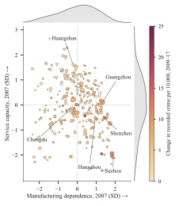

# The Other Side of Progress

## High-Tech Expansion and Urban Crime

**Undergraduate thesis, Jintao Lyu, advisor Lanlan Wang** · [Back to selected research](../README.md)

## Question

When high-tech industry grows in a Chinese city, who benefits, and does uneven opportunity show up in recorded crime? I also ask whether the answer depends on where the city started, in particular how much it relied on manufacturing and how much room its service sector had to absorb workers.

I built the data myself. I classified about **7.5 million firm-year records** from China's national tax survey (2007–2020) into high-tech and other industries, aggregated them into city-level high-tech shares, and linked these with recorded criminal cases and the China City Statistical Yearbook. The estimation panel covers **280 cities and 2,464 city-years from 2009 to 2017**.

## Key findings

All estimates use city and year fixed effects, with standard errors clustered by city.

- Cities with a higher high-tech share record more crime. A one-percentage-point higher high-tech share in the previous year is associated with 0.48 more recorded criminal cases per 10,000 residents (SE 0.15, p = 0.001), about 0.16 of a standard deviation.
- The association depends on the city's starting structure. In exploratory interaction models it is stronger in cities that depended more on manufacturing (0.30 SD more at the 75th than at the 25th percentile) and weaker where service capacity was high (0.23 SD less).
- A higher high-tech share also goes with a wider urban–rural income gap, more knowledge-intensive jobs, more employment polarization and a smaller manufacturing share of secondary-sector jobs, each by 0.06–0.07 SD.

## Figures


Each row is a separate regression, and each estimate is divided by the standard deviation of its outcome. Bars are 95% confidence intervals.

| Row | City-years | Cities |
|---|---:|---:|
| Recorded crime | 2,464 | 280 |
| Manufacturing and service interactions | 2,447 | 276 |
| Urban–rural income ratio | 2,420 | 275 |
| Manufacturing share of secondary employment | 2,461 | 280 |
| Knowledge-intensive employment | 2,173 | 280 |
| Employment polarization | 2,061 | 279 |



Each marker is a city, placed by its manufacturing dependence and service capacity in 2007. Marker size shows the change in the high-tech share from 2009 to 2017, with triangles for cities where it fell. Colour shows the change in recorded crime. Hollow squares mark the 11 of 276 cities that lack data for one of the two years.

## My contribution

- I cleaned and classified the 7.5 million tax-survey records, built the city-level high-tech share, and linked it with crime and city statistics.
- I estimated the fixed-effects and Poisson (PPML) models, the interaction models and the regressions on related outcomes.
- I made the figures in this repository.

## Code

| File | Role |
|---|---|
| [code/01_clean_firm_data.do](code/01_clean_firm_data.do) | Cleans the 2007–2020 tax-survey records into a firm-year file with four-digit industry codes, and applies the list of 181 high-tech codes |
| [code/02_construct_hightech_treatment.do](code/02_construct_hightech_treatment.do) | Turns the firm-year file into each city's yearly high-tech share (high-tech firms as a percentage of all firms) |
| [code/03_build_city_year_panel.do](code/03_build_city_year_panel.do) | Merges the high-tech share with recorded crime and city statistics into the city-year panel |
| [code/baseline_L1.do](code/baseline_L1.do) | Runs the baseline regression and checks that it reproduces the reported estimate |

The tax-survey, crime and city data are restricted and not included. With the data placed under `02_data/raw/`, run the scripts in Stata 18 with `reghdfe` and `ftools` installed:

```stata
global root "path/to/project"
do "high-tech-and-urban-crime/code/01_clean_firm_data.do"
do "high-tech-and-urban-crime/code/02_construct_hightech_treatment.do"
do "high-tech-and-urban-crime/code/03_build_city_year_panel.do"
do "high-tech-and-urban-crime/code/baseline_L1.do" "$root/02_data/analysis_ready/baseline_city_year_v03.dta" "high-tech-and-urban-crime/outputs/baseline"
```

The baseline regression is

```stata
reghdfe crime_rate_10k_corrected L1_hitech_share_all ///
    L1_secondary_ind_legacy L1_ln_unemp_legacy ///
    L1_ln_gov_expen_legacy L1_ln_gdp_per_legacy ///
    if sample_preferred_core, absorb(city_code year) vce(cluster city_code)
```

`baseline_L1.do` stops unless it reproduces b = 0.4829, SE = 0.1453, N = 2,464 and 280 cities. When I reran it with Stata 18 on 14 October 2026, it matched all four.

## Limitations

- The estimates are conditional associations, not causal effects. I am still working on a design that can identify the effect of high-tech expansion.
- Recorded crime depends on reporting and policing as well as on how much crime occurs.
- Many firm records have no usable industry code, so the high-tech share is measured with error.

[Back to selected research](../README.md)
