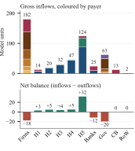

# Jobs or Transfers?

## Job Guarantees, Fiscal Design, and the Dynamics of Inequality

**Working paper · Jintao Lyu and Huiqing Li** · [Back to selected research](../README.md)

## Question

Should a government spend a fixed budget on guaranteed public jobs or on cash transfers, and who gains under each? I answer this with a stock-flow consistent (SFC) macro-financial model in which every payment has a payer and a recipient, so policy effects on demand, profits, debt and wealth stay consistent with one another.

The model has five household income groups (H1 lowest to H5 highest), firms, commercial banks, government, a central bank and the rest of the world. Six policy designs, plus a no-policy baseline, are run in four macroeconomic states over two horizons (56 scenarios). Every policy has the same **net** fiscal cost, 1.5% of pre-policy GDP after project revenue, so the comparison is between uses of the same money.

## Key findings

Normal macroeconomic state, 40 periods after the policy starts, average of the stochastic simulation paths, relative to the no-policy baseline:

- **Job guarantees raise output far more.** Output is 5.6% higher with an employment-scale job guarantee and 6.2% higher with a wage-priority job guarantee (both debt-financed), against 1.0% for a transfer financed by a high-income tax. The employment-scale design brings unemployment down to 0.2%, from 7.1% in the baseline.
- **Tax-financed transfers do more for relative equality.** The income Gini across the five groups falls by 3.3% with the transfer, against 1.1% and 1.8% with the two job guarantees. The bottom 40% income share rises by 7.2%, against 3.7% and 4.9%.
- **Why the gap.** An income-source decomposition of the Gini shows that the job guarantees' extra output also raises profit and dividend income at the top (H5), which offsets part of their equalizing effect.

## Figures

All three figures show the same baseline simulation in one period (model units).

**Payments between sectors.** Each ribbon is a payment, coloured by the payer.


**Gross inflows and net balances.** What each sector receives, by payer, and its net position.



**Household income and its uses.** Wages, transfers and property income flow through H1–H5 to consumption, taxes, rent and debt interest, and saving.


## My contribution

- Built the model in R: household balance sheets, consumption, debt, housing and portfolios for five income groups, and the links to firms, banks and the state.
- Designed and ran the 56 scenarios with the equal-net-cost rule, and decomposed private sales, investment, employment and income-source inequality.
- Made the figures in this repository.

## Run the model

Requires R and the `ineq` package (`install.packages("ineq")`). No data files are needed. From the repository root:

```sh
Rscript --vanilla jobs-or-transfers/code/run_example.R N0
```

`N0` is the baseline. `N1`–`N6` run the policies: N1/N6 employment-scale job guarantee, N2/N5 wage-priority job guarantee, N3/N4 transfer; N1, N2 and N4 are debt-financed, N3, N5 and N6 tax-financed. A run takes one to three minutes and writes to `jobs-or-transfers/outputs/<scenario>/`:

| File | Contents |
|---|---|
| `model_series.csv` | Main model variables, all ten paths, periods 56–100 |
| `income_source_contributions.csv` | Gini and squared-CV contributions by income source |
| `checks.csv` | 46 accounting and consistency checks with PASS/FAIL |
| `run.log`, `session_info.txt` | Run record and software versions |

The run stops if any check fails. On R 4.6.1, N0 and N1 pass all 46 checks with residuals below 10⁻¹¹.

| Code file | Role |
|---|---|
| [code/equation_ap_csv1.R](code/equation_ap_csv1.R) | The model: parameters, sector equations, policy rules and the solution loop |
| [code/model_analysis.R](code/model_analysis.R) | Income-source inequality decompositions and balance-sheet residuals |
| [code/run_example.R](code/run_example.R) | Runs one scenario, checks it and writes the outputs |

## Limitations

- The five groups are representative households, so the inequality measures are between groups, not survey-based population estimates.
- Parameters are partly calibrated to Chinese data but not estimated; the results compare scenarios and are not forecasts.
- Each period is solved with a fixed number of iterations rather than a convergence tolerance; the accounting checks above confirm consistency of the solved values.

[Back to selected research](../README.md)
