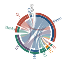
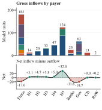
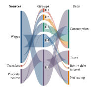

# Jobs or Transfers?

## Job Guarantees, Fiscal Design, and the Dynamics of Inequality

**Working paper · Jintao Lyu and Huiqing Li**  
[Back to selected research](../README.md)

[Research question](#research-question) · [Run the model](#run-the-model-example) · [Selected visualizations](#selected-visualizations) · [Availability](#interpretation-and-availability)

## Research question

How do job guarantees and targeted transfers transmit through household demand, private activity and income distribution, and how do those outcomes depend on fiscal design?

The project uses a stock-flow consistent computational macro-financial model with five heterogeneous household groups. It connects public intervention to household spending, private sales, investment, employment and profit–dividend income. Comparisons use a common net fiscal cost, accounting for program revenue rather than equating gross expenditure.

## My contribution

- Developed the computational model in R, representing differences in household income, consumption, wealth, debt and financial portfolios.
- Implemented 56 policy–macroeconomic-state–horizon configurations, including baseline configurations, and examined private-sector responses and income-source inequality.
- Constructed the selected visualizations to make intersectoral payments, household income and spending uses inspectable.

The figures below are **baseline structural views**, not a presentation of all 56 configurations or a comparison of policy effects. The [research-code example](#run-the-model-example) lets readers inspect and run the actual formal model separately from the figures.

## Run the model example

### Scope and file guide

The smallest useful runnable package preserves the model's full linked equation system. Removing the banks, fiscal accounts or household stock updates to obtain a shorter "toy" would change the research object. Instead, this example keeps the original core and reduces the surrounding orchestration.

| File | Responsibility |
|---|---|
| [code/equation_ap_csv1.R](code/equation_ap_csv1.R) | Unchanged snapshot of the original formal model: parameters, initialization, five household groups, firms, banks, government, central bank, foreign sector and within-period iteration |
| [code/model_analysis.R](code/model_analysis.R) | Original income-source allocation, Lerman–Yitzhaki Gini and squared-CV decomposition kernels, and existing balance-sheet residual functions, extracted without their whole-project I/O |
| [code/run_example.R](code/run_example.R) | A small portable runner: selects a normal-state policy, runs the core, performs explicitly scoped checks and writes CSV results |

### Requirements and command

- R with the `ineq` package. The local runtime used for validation is R 4.6.1 with `ineq` 0.2.13; other versions and operating systems are not automatically validated.
- No input files, tax-survey data, pre-generated `.RData`, Python, Stata, Typst or plotting packages are needed.
- If `ineq` is absent, install it explicitly in R with `install.packages("ineq")`. The runner does not install software.

From the repository root:

```sh
Rscript --vanilla jobs-or-transfers/code/run_example.R N0
```

This runs the normal-state baseline with the original **100 periods, 10 paths and 100 fixed sweeps per period**. The default destination is `jobs-or-transfers/outputs/N0/`. Existing nonempty output directories are protected; supply a new destination to run again:

```sh
Rscript --vanilla jobs-or-transfers/code/run_example.R N1 jobs-or-transfers/outputs/N1
```

`N0` selects the baseline. `N1`–`N6` select the corresponding original policy rules: N1 employment-scale-priority/debt; N2 wage-priority/debt; N3 transfer/high-income tax; N4 transfer/debt; N5 wage-priority/high-income tax; N6 employment-scale-priority/high-income tax. The runner limits execution to the normal macro state and preserves the fixed prepolicy-GDP net-cost rule. The parent directory for a custom R output destination can be created by the runner.

### Outputs and checks

| Output | Contents |
|---|---|
| `model_series.csv` | Scenario, path, period and original model variables, for all ten paths at periods 56–100; names retain the original notation |
| `income_source_contributions.csv` | Six-channel income-Gini and squared-CV contributions at period 100, separately for paths 3–10 |
| `checks.csv` | Explicit finite-value, positivity, balance-sheet, selected accounting, fiscal-cost and income-decomposition checks with tolerances and PASS/FAIL |
| `run.log`, `session_info.txt` | Scenario, software, success/failure, elapsed time and R package/session information |

The runner preserves path conventions: path 1 is the unperturbed baseline; policy intervention applies from period 60 to paths 2–10; paths 3–10 use the model's path-specific parameter draws. Do not average across all ten paths to reproduce the parent study's paths-3–10 policy summaries.

Checks span all paths at periods 2–100 for the selected accounting relations. Income-source reconciliation uses periods 56–100, and the inequality-kernel comparison uses period 100 at paths 3–10. Passing these checks is **scoped numerical evidence**, not an audit of every equation, a complete transaction-flow matrix, empirical validation or a proof of within-period convergence. Failed checks stop the runner and retain its log and check table.

### Numerical and economic boundaries

- The original source uses **100 fixed sweeps**, rather than terminating when a residual tolerance is achieved. The example does not alter that solver or certify its convergence.
- The source calls `set.seed(j)` inside the time and iteration loops. It reproduces path-specific draws instead of generating fresh independent innovations every period; the original behavior is retained.
- This is the **formal model**, not the independent B private-output/labor variant. For example, its employment expression is `nd = (y - wbg) / prf`; it must not be silently relabeled as the B price-consistent expression `y / (prf * pf)`. Employment variables are normalized model quantities, not observed headcounts.
- The five-group income-Gini decomposition is an equal-group model calculation, not a survey-weighted population estimate. Its algorithm follows the source-decomposition implementation attributed in the parent code to Lerman and Yitzhaki (1985).
- The original file's separate `gini_nv` calculation clips negative group net wealth at zero. This example exports the income Gini, not that clipped series as a general wealth-inequality result.

### Source provenance

The core was copied unchanged from the inspected formal implementation `model/equation_ap_csv1.R`. Analysis function bodies come from `analysis/gini_decomposition.R` and `analysis/analyze_results.R`; project-path lookup, figure styling and whole-project table generation were excluded. The runner is new packaging around that existing implementation, not a new economic model.

Snapshot date: **14 October 2026**. The parent working tree contains local research changes; this snapshot is not presented as a released Git commit or as the full current parent repository. Joint authorship and theoretical-method provenance remain applicable. No source data or private Git history are bundled.

### Local validation, 14 October 2026

On Windows, using R 4.6.1 and `ineq` 0.2.13, the default **N0 example completed in approximately 177 seconds**, with all **46 scoped checks passing**. The largest absolute residual among those checks was approximately **3.94 × 10⁻¹² model units**. The 19 exported model variables matched the parent project's saved formal N0 results across all 450 exported path–period cells per variable; the maximum CSV/readback difference was approximately **5.12 × 10⁻¹³**.

The **N1 employment-scale-priority/debt scenario** also completed in approximately **179 seconds**, passing all **46 scoped checks** with a maximum absolute residual of approximately **5.29 × 10⁻¹²**. Its policy paths have nonzero net fiscal costs, so this also exercises the fiscal-cost check beyond the zero-policy baseline. N2–N6 are available through the unchanged core but were not freshly run for this collection.

These checks establish agreement for the selected baseline outputs and listed relations. They do not extend to all 56 configurations, independent B variants, within-period solver convergence or validation against observed Chinese time series. Initial Windows locale warnings were present; the wrapper explicitly selects a UTF-8 character locale when needed to support Unicode paths, without modifying the model's numerical rules.

## Selected visualizations

All three figures refer to the **same saved baseline snapshot: path 1, period 60**. Monetary amounts are expressed in model units per period; they are simulated flows, not observed currency amounts or counts of people.

### 1. Intersectoral cash flows

[](figures/19_chord.svg)

[Open the vector figure](figures/19_chord.svg)

The chord diagram makes selected payments between household groups and institutions visible. Colors identify payers; ribbon widths represent the recorded payment amounts. Household groups H1–H5 run from lower to higher income.

**Scope:** this is a selected cash-flow view. It is not the complete transaction-flow matrix or a test of the full model's accounting consistency.

### 2. Flow composition and sector balances

[](figures/19_composition.svg)

[Open the vector figure](figures/19_composition.svg)

The stacked bars show the composition of the selected flows. The lower wave connects the corresponding sector balances to help the reader compare positions within the economic circuit.

**Reading the wave:** the horizontal axis lists **sector categories, not time**. Interpolation between categories is a visual guide; it does not describe a temporal trajectory or additional economic observations. A balance refers only to the transactions covered here, not automatically to net lending or a change in net worth.

### 3. Household income and uses

[](figures/20_income_uses.svg)

[Open the vector figure](figures/20_income_uses.svg)

Current-period wages, transfers and property income flow through H1–H5 to consumption, taxes, rent/debt interest and net saving. The figure highlights how households occupy different positions in the income and spending circuit.

For this saved snapshot, the maximum absolute difference between each household group's displayed income and uses is approximately **2.84 × 10⁻¹⁴ model units**. This is a local reconciliation of the displayed household flows. It does not establish full balance-sheet, transaction-flow or stock–flow-bridge validity.

## Methods and provenance

The figures were prepared from a saved `Data_N0.RData` baseline output, using path 1 at period 60. Preparation read existing outputs; it did not re-solve the model or alter behavioral parameters.

The selected payment matrix includes both bank profits distributed to H5 and deposit interest. These payments are added rather than allowing one assignment to overwrite the other. The household income–uses view retains actual current-period flows without inserting artificial positive minima or a residual asset allocation to force a balance.

These details concern the construction and coverage of the visualizations. They do not change the underlying research model or establish independent empirical validation.

## Interpretation and availability

- The project studies policy transmission; this particular selection displays the baseline economic circuit. Policy rankings cannot be read from these three figures alone.
- Five household groups represent modeled heterogeneity. Group-based inequality measures should not be interpreted as microdata population estimates.
- Joint authorship is retained. The contribution statement above describes my work within the project.
- This collection provides three SVG figures, the original formal equation snapshot and focused model/analysis examples. Generated outputs, all 56 configurations, independent variants and the full paper workflow are not bundled.
- The selected figures were prepared from previously saved results. Running the code example does not regenerate their visual design, and its verification scope is documented above; the local figure reconciliation is distinct from a full-model verification.

[Back to selected research](../README.md)
