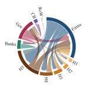

# Jobs or Transfers?

## Job Guarantees, Fiscal Design, and the Dynamics of Inequality

**Working paper, Jintao Lyu and Huiqing Li** · [Back to selected research](../README.md)

## Question

If a government has a fixed budget, should it pay for guaranteed public jobs or for cash transfers, and who gains in each case? I study this with a stock-flow consistent (SFC) macro-financial model. In an SFC model every payment has a payer and a recipient, so the effects of a policy on spending, profits, debt and wealth have to add up.

The model has five household income groups (H1 lowest to H5 highest), firms, commercial banks, a government, a central bank and a foreign sector. I run six policy designs and a no-policy baseline in four macroeconomic states and over two horizons, 56 scenarios in total. Every policy has the same net cost to the government, 1.5% of pre-policy GDP after any revenue from the jobs programme, so the scenarios compare different uses of the same money.

## Key findings

The numbers below are for the normal macroeconomic state, 40 periods after the policy starts, averaged over the stochastic simulation paths and compared with the no-policy baseline.

- How a policy is financed matters more for output than what it buys. With debt finance, output is 5.6% higher with a job guarantee that maximizes employment, 6.2% higher with one that pays a higher wage, and 6.7% higher with a transfer. A transfer paid for by a tax on high incomes raises output by only 1.0%.
- Job guarantees do far more for unemployment. The employment-maximizing job guarantee lowers unemployment to 0.2%, against 6.9% with the debt-financed transfer and 7.1% in the baseline.
- Transfers reduce relative inequality more under either kind of financing. With debt finance, the income Gini across the five groups falls by 2.2% with the transfer and by 1.1% and 1.8% with the two job guarantees. With the high-income tax, it falls by 3.3% with the transfer and 2.9% with the higher-wage job guarantee.
- A decomposition of the Gini by income source explains the difference. The extra output under a job guarantee also raises profit and dividend income for the top group (H5), which offsets part of the fall in inequality.

## Figures

Both figures show the baseline simulation in a single period, in model units.



Payments between sectors. Each ribbon runs from payer to recipient in the payer's colour. The outer ring shows each sector's net balance, green for a surplus and red for a deficit. Gov is the government, CB the central bank and RoW the rest of the world.


Household sources and uses of funds. Money flows from the payers (government, firms, banks and tenants) through each type of income to the five household groups, then to consumption, loan interest, rent, taxes and asset purchases, and finally to the assets each group buys. For every group, saving plus new borrowing equals the assets it buys. Capital gains on shares change the value of wealth but are not payments, so they are not shown.

## My contribution

- I built the model in R, including the balance sheets, consumption, debt, housing and portfolios of the five household groups and their links to firms, banks and the state.
- I designed and ran the 56 scenarios under the equal-net-cost rule, and decomposed private sales, investment, employment and income inequality by source.
- I made the figures in this repository.

## Run the model

You need R and the `ineq` package (`install.packages("ineq")`). No data files are needed. From the repository root:

```sh
Rscript --vanilla jobs-or-transfers/code/run_example.R N0
```

`N0` is the baseline and `N1` to `N6` are the policies. N1 and N6 are the employment-maximizing job guarantee, N2 and N5 the higher-wage job guarantee, and N3 and N4 the transfer. N1, N2 and N4 are financed by debt, and N3, N5 and N6 by a tax on high incomes. A run takes one to three minutes and writes these files to `jobs-or-transfers/outputs/<scenario>/`:

| File | Contents |
|---|---|
| `model_series.csv` | Main model variables for all ten paths, periods 56–100 |
| `income_source_contributions.csv` | Contributions of each income source to the Gini and the squared coefficient of variation |
| `checks.csv` | 46 accounting and consistency checks, each marked PASS or FAIL |
| `run.log`, `session_info.txt` | Run record and software versions |

The run stops if any check fails. With R 4.6.1, N0 and N1 pass all 46 checks with residuals below 10⁻¹¹.

| Code file | Role |
|---|---|
| [code/equation_ap_csv1.R](code/equation_ap_csv1.R) | The model, with its parameters, sector equations, policy rules and solution loop |
| [code/model_analysis.R](code/model_analysis.R) | Inequality decompositions by income source and balance-sheet residuals |
| [code/run_example.R](code/run_example.R) | Runs one scenario, checks it and writes the outputs |

## Limitations

- The five groups are representative households, so the inequality measures compare groups and are not estimates for the whole population.
- Some parameters are calibrated to Chinese data, but none are estimated. The results compare scenarios and are not forecasts.
- Each period is solved with a fixed number of iterations rather than a convergence tolerance. The accounting checks confirm that the solved values are consistent.

[Back to selected research](../README.md)
